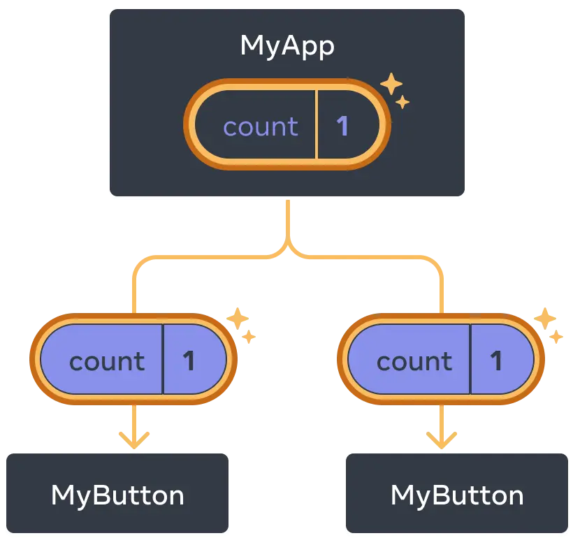
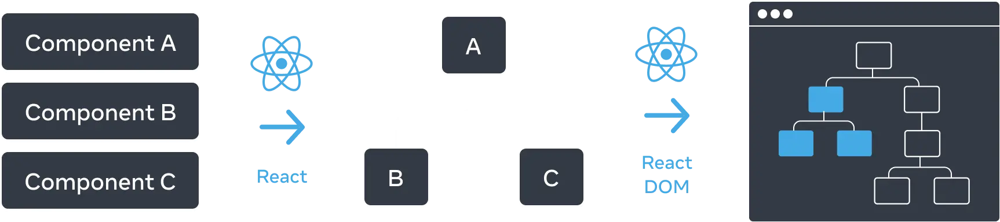
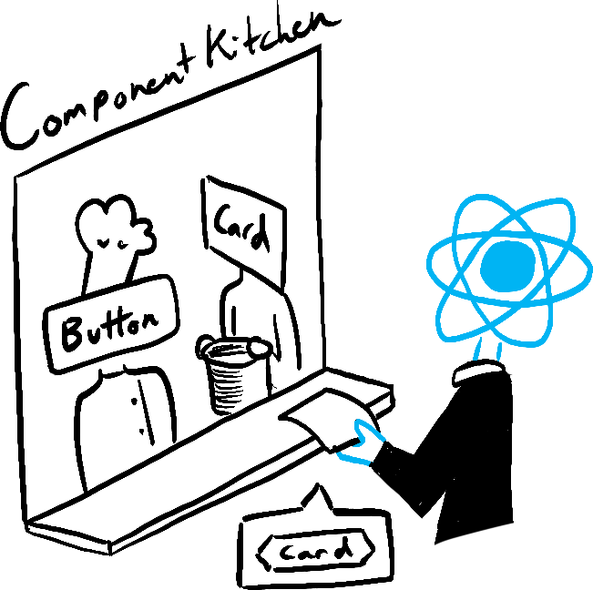

// React - component based architecture 

React components are JavaScript functions that return markup

function MyButton() {
  return (
    <button>I'm a button</button>
  );
}
now that i have declared Mybutton i can nest it into another component
export default function MyApp() {
  return (
    

      <h1>Welcome to my app</h1>
      <MyButton />
    

  );
}
the export default keywords specify the main component in the file.

Writing markup with JSX for this you can use online converter

Adding styles -> you can do this by specifying a CSS class with className

/* In your CSS */
.avatar {
  border-radius: 50%;
}

You can also “escape into JavaScript” from JSX attributes, but you have to use curly braces instead of quotes.
return (
  
);
const user = {
  name: 'Hedy Lamarr',
  imageUrl: 'https://react.dev/images/docs/scientists/yXOvdOSs.jpg',
  imageSize: 90,
};

export default function Profile() {
  return(
    <>
      <h1>{user.name}</h1>
      
    </>
  );
}

Conditional Rendering
let content;
if (isLoggedIn) {
  content = <AdminPanel />;
} else {
  content = <LoginForm />;
}
return (
  

    {content}
  

);

When you don’t need the else branch, you can also use a shorter logical && syntax:

  {isLoggedIn && <AdminPanel />}

Rendering Lists

const listItems = products.map(products => 
   <li key={product.id}>
      {product.title}
   </li>
);

return(
   <ul>{listItems}</ul>
);

const products = [
  { title: 'Cabbage', isFruit: false, id: 1 },
  { title: 'Garlic', isFruit: false, id: 2 },
  { title: 'Apple', isFruit: true, id: 3 },
];

export default function ShoppingList() {
  const listItems = products.map(product =>
    <li
      key={product.id}
      style={{
        color: product.isFruit ? 'magenta' : 'darkgreen'
      }}
    >
      {product.title}
    </li>
  );

  return (
    <ul>{listItems}</ul>
  );
}

Responding to events 
You can respond to events by declaring event handler functions inside your components:

function MyButton() {
  function handleClick() {
    alert('You clicked me!');
  }

  return (
    <button onClick={handleClick}>  //Notice how onClick={handleClick} has no parentheses at the end! Do not call the event handler function: you only need to pass it down. React will call your event handler when the user clicks the button.
      Click me
    </button>
  );
}
Updating the screen
import {use state} from 'react';
function Mybutton(){
   const[count,setCount] = useState(0);
   
count will be 0 because you passed 0 to useState(). When you want to change state, call setCount() and pass the new value to it. Clicking this button will increment the counter.

  function handleClick() {
    setCount(count + 1);
  }

  return (
    <button onClick={handleClick}>
      Clicked {count} times
    </button>
  );
}

Using Hooks!

Functions starting with use are called Hooks eg useState!

[alt text](sharing_data_parent.png)

Now when you click either button, the count in MyApp will change, which will change both of the counts in MyButton. Here’s how you can express this in code.

First, move the state up from MyButton into MyApp:

export default function MyApp() {
  const [count, setCount] = useState(0);

  function handleClick() {
    setCount(count + 1);
  }

  return (
    

      <h1>Counters that update separately</h1>
      <MyButton />
      <MyButton />
    

  );
}

function MyButton() {
  // ... we're moving code from here ...
}
Then, pass the state down from MyApp to each MyButton, together with the shared click handler. You can pass information to MyButton using the JSX curly braces, just like you previously did with built-in tags like :

export default function MyApp() {
  const [count, setCount] = useState(0);

  function handleClick() {
    setCount(count + 1);
  }

  return (
    

      <h1>Counters that update together</h1>
      <MyButton count={count} onClick={handleClick} />
      <MyButton count={count} onClick={handleClick} />
    

  );
}
The information you pass down like this is called props
Finally, change MyButton to read the props you have passed from its parent component:

function MyButton({ count, onClick }) {
  return (
    <button onClick={onClick}>
      Clicked {count} times
    </button>
  );
}

# Describing the UI

# First React Component

Components: UI building blocks 
On the Web, HTML lets us create rich structured documents with its built-in set of tags like <h1> and <li>

the documentation page you’re reading is made out of React components
<PageLayout>
  <NavigationHeader>
    <SearchBar />
    <Link to="/docs">Docs</Link>
  </NavigationHeader>
  <Sidebar />
  <PageContent>
    <TableOfContents />
    <DocumentationText />
  </PageContent>
</PageLayout>

Importing and Exporting Components
The magic of components lies in their reusability: you can create components that are composed of other components. But as you nest more and more components, it often makes sense to start splitting them into different files

import Gallery from './Gallery.js';

Writing Markup with JSX
JSX is a syntax extension for JavaScript that lets you write HTML-like markup inside a JavaScript file. Although there are other ways to write components, most React developers prefer the conciseness of JSX, and most codebases use it.

Keeping a button’s rendering logic and markup together ensures that they stay in sync with each other on every edit.
Converting HTML to JSX 
Suppose that you have some (perfectly valid) HTML:

<h1>Hedy Lamarr's Todos</h1>

<ul>
    <li>Invent new traffic lights
    <li>Rehearse a movie scene
    <li>Improve the spectrum technology
</ul>

<> and </> -> is called fragment 

why every tag must be closed ->camelCase all most of the things! 
JSX turns into JavaScript and attributes written in JSX become keys of JavaScript objects. In your own components, you will often want to read those attributes into variables. But JavaScript has limitations on variable names

Where to use curly braces 
You can only use curly braces in two ways inside JSX:

As text directly inside a JSX tag: <h1>{name}'s To Do List</h1> works, but <{tag}>Gregorio Y. Zara's To Do List</{tag}> will not.
As attributes immediately following the = sign: src={avatar} will read the avatar variable, but src="{avatar}" will pass the string "{avatar}".

Inline style properties are written in camelCase.

Passing Props to a Component
React components use props to communicate with each other. Every parent component can pass some information to its child components by giving them props. Props might remind you of HTML attributes, but you can pass any JavaScript value through them, including objects, arrays, and functions

Props let you think about parent and child components independently.

, props are immutable—a term from computer science meaning “unchangeable”. When a component needs to change its props (for example, in response to a user interaction or new data), it will have to “ask” its parent component to pass it different props—a new object! Its old props will then be cast aside, and eventually the JavaScript engine will reclaim the memory taken by them.

#Conditional Rendering 

Conditional rendering means displaying different UI elements based on a condition.

Just like we use if-else in JavaScript to make decisions, React lets us decide what to display on the screen depending on a condition.

For example:
- If a user is logged in → show the Dashboard.
- If a user is not logged in → show the Login button.
- If data is loading → show a Loading message.
Let's understand it step by step.
1. Using if-else
You can use normal JavaScript if-else statements to decide what a component should return.
function App() {
  const isLoggedIn = true;

  if (isLoggedIn) {
    return <h1>Welcome Back!</h1>;
  } else {
    return <h1>Please Login</h1>;
  }
}

export default App;

Output:
Welcome Back!
Because isLoggedIn is true.

If isLoggedIn becomes false, the output will be Please Login.

Remember: With if-else, you generally use separate return statements for the different UI outcomes.
2. Using the ternary operator ? :
This is useful when you want to render one of two elements inside JSX.

Syntax:
condition ? expressionIfTrue : expressionIfFalse

Example:
function App() {
  const isLoggedIn = false;

  return (
    

      {isLoggedIn ? <h1>Welcome!</h1> : <h1>Please Login</h1>}
    

  );
}

Output: Please Login

How it works:
- isLoggedIn is true → render Welcome!
- isLoggedIn is false → render Please Login
The curly braces {} allow you to write JavaScript expressions inside JSX.
3. Using the logical AND operator &&
Use && when you want to display something only if a condition is true. If the condition is false, nothing is rendered from the expression.
function App() {
  const hasMessage = true;

  return (
    

      <h1>My App</h1>
      {hasMessage && 
You have a new message!
}
    

  );
}

Output:
My App
You have a new message!

If hasMessage is false, the paragraph won't appear.

Important interview point: Avoid writing {count && 
...
} when count can be 0, because JavaScript may render the number 0 on the screen. Instead, use {count > 0 && 
...
}.
4. Using a variable
You can store the JSX in a variable and then render it.
function App() {
  const isAdmin = true;

  let content;

  if (isAdmin) {
    content = <h1>Admin Dashboard</h1>;
  } else {
    content = <h1>User Dashboard</h1>;
  }

  return 
{content}
;
}

Arrow functions implicitly return the expression right after =>, so you didn’t need a return statement:

const listItems = chemists.map(person =>
  <li>...</li> // Implicit return!
);

However, you must write return explicitly if your => is followed by a { curly brace!

const listItems = chemists.map(person => { // Curly brace
  return <li>...</li>;
});
Arrow functions containing => { are said to have a “block body”. They let you write more than a single line of code, but you have to write a return statement yourself. If you forget it, nothing gets returned

Keeping list items in order with key 
Notice that all the sandboxes above show an error in the console:

Console
Warning: Each child in a list should have a unique “key” prop.
You need to give each array item a key — a string or a number that uniquely identifies it among other items in that array:

<li key={person.id}>...</li>

What do you do when each item needs to render not one, but several DOM nodes?

The short <>...</> Fragment syntax won’t let you pass a key, so you need to either group them into a single 
, or use the slightly longer and more explicit <Fragment> syntax:

Rules of keys 
Keys must be unique among siblings. However, it’s okay to use the same keys for JSX nodes in different arrays.
Keys must not change or that defeats their purpose! Don’t generate them while rendering.
Note that your components won’t receive key as a prop. It’s only used as a hint by React itself. If your component needs an ID, you have to pass it as a separate prop: <Profile key={id} userId={id} />.

# Keeping a component pure -> a pure component gives the same output for the same inputs and does not change anything outside itself during rendering.

Rules for keeping components pure
1. Don't change props. Props are read-only.
2. Don't modify external variables during rendering.
3. Don't perform side effects during rendering, such as making API calls or modifying the DOM directly.
4. Keep rendering calculations predictable. The same inputs should produce the same JSX.

# Understand your UI as tree

Trees are a relationship model between items. The UI is often represented using tree structures. For example, browsers use tree structures to model HTML (DOM) and CSS (CSSOM). Mobile platforms also use trees to represent their view hierarchy.

-> Render tree

# Adding interactivity
 screen update in response to user input. For example, clicking an image gallery switches the active image. In React, data that changes over time is called state

# responding to events 

export default function App() {
  return (
    <Toolbar 
      onPlayMovie={() => alert('Playing!')}
      onUploadImage={() => alert('Uploading!')} // it will generate alert while we click on this 

    />
  );
}

function Toolbar({ onPlayMovie, onUploadImage }) {
  return (
    

      <Button onClick={onPlayMovie}>
        Play Movie
      </Button>
      <Button onClick={onUploadImage}>
        Upload Image
      </Button>
    

  );
}

function Button({ onClick, children }) {
  return (
    <button onClick={onClick}>
      {children}
    </button>
  );
}

State A component's memory ->

When a regular variable isn’t enough 
Here’s a component that renders a sculpture image. Clicking the “Next” button should show the next sculpture by changing the index to 1, then 2, and so on. However, this won’t work (you can try it!):

import { sculptureList } from './data.js';

export default function Gallery() {
  let index = 0;

  function handleClick() {
    index = index + 1;
  }

  let sculpture = sculptureList[index];
  return (
    <>
      <button onClick={handleClick}>
        Next
      </button>
      <h2>
        <i>{sculpture.name} </i>
        by {sculpture.artist}
      </h2>
      <h3>
        ({index + 1} of {sculptureList.length})
      </h3>
      
      

        {sculpture.description}
      

    </>
  );
}

Show more
The handleClick event handler is updating a local variable, index. But two things prevent that change from being visible:

Local variables don’t persist between renders. When React renders this component a second time, it renders it from scratch—it doesn’t consider any changes to the local variables.
Changes to local variables won’t trigger renders. React doesn’t realize it needs to render the component again with the new data.

To update a component with new data, two things need to happen:

Retain the data between renders.
Trigger React to render the component with new data (re-rendering).
The useState Hook provides those two things:

A state variable to retain the data between renders.
A state setter function to update the variable and trigger React to render the component again.

Adding a state variable 
import {useState} from 'react'
instead of let index=0;
we will use const [index,setIndex] = useState(0);

[and] it is called array destruction 

Meet your first Hook

in react function starting with use are called hooks

Hooks—functions starting with use—can only be called at the top level of your components or your own Hooks. You can’t call Hooks inside conditions, loops, or other nested functions. Hooks are functions, but it’s helpful to think of them as unconditional declarations about your component’s needs. You “use” React features at the top of your component similar to how you “import” modules at the top of your file.

Hooks are special functions that let functional components use React features such as state, lifecycle-related behavior, context, and references.

-> useState in this u are telling react to remember something
const[index.setIndex]=useState(0)

Render and Commit
Before your components are displayed on screen, they must be rendered by React

TRIGGER 
import Image from './Image.js';
import { createRoot } from 'react-dom/client';

const root = createRoot(document.getElementById('root'))
root.render(<Image />); //INITIAL TRIGGER
After you trigger a render, React calls your components to figure out what to display on screen. “Rendering” is React calling your components.

On initial render, React will call the root component.
For subsequent renders, React will call the function component whose state update triggered the render.

Step 3: React commits changes to the DOM 
After rendering (calling) your components, React will modify the DOM.

For the initial render, React will use the appendChild() DOM API to put all the DOM nodes it has created on screen.
For re-renders, React will apply the minimal necessary operations (calculated while rendering!) to make the DOM match the latest rendering output.

Browser paint 
After rendering is done and React updated the DOM, the browser will repaint the screen. Although this process is known as “browser rendering”, we’ll refer to it as “painting” to avoid confusion throughout the docs.

State as a Snapshot
State variables might look like regular JavaScript variables that you can read and write to. However, state behaves more like a snapshot. Setting it does not change the state variable you already have, but instead triggers a re-render.

When React re-renders a component:

React calls your function again.
Your function returns a new JSX snapshot.
React then updates the screen to match the snapshot your function returned.

Updating the same state multiple times before the next render 
It is an uncommon use case, but if you would like to update the same state variable multiple times before the next render, instead of passing the next state value like setNumber(number + 1), you can pass a function that calculates the next state based on the previous one in the queue, like setNumber(n => n + 1). It is a way to tell React to “do something with the state value” instead of just replacing it.
React
v19.3
Search
Ctrl
K

Learn React
Adding Interactivity

Copy page
Queueing a Series of State Updates
Setting a state variable will queue another render. But sometimes you might want to perform multiple operations on the value before queueing the next render. To do this, it helps to understand how React batches state updates.

You will learn
What “batching” is and how React uses it to process multiple state updates
How to apply several updates to the same state variable in a row
React batches state updates 
You might expect that clicking the “+3” button will increment the counter three times because it calls setNumber(number + 1) three times:

App.js
Download

Reload

Clear

Fork
1
2
3
4
5
6
7
8
9
10
11
12
13
14
15
16
17
import { useState } from 'react';

export default function Counter() {
  const [number, setNumber] = useState(0);

  return (
    <>
      <h1>{number}</h1>
      <button onClick={() => {
        setNumber(number + 1);
        setNumber(number + 1);
        setNumber(number + 1);
      }}>+3</button>
    </>
  )
}

Show more
However, as you might recall from the previous section, each render’s state values are fixed, so the value of number inside the first render’s event handler is always 0, no matter how many times you call setNumber(1):

setNumber(0 + 1);
setNumber(0 + 1);
setNumber(0 + 1);
But there is one other factor at play here. React waits until all code in the event handlers has run before processing your state updates. This is why the re-render only happens after all these setNumber() calls.

This might remind you of a waiter taking an order at the restaurant. A waiter doesn’t run to the kitchen at the mention of your first dish! Instead, they let you finish your order, let you make changes to it, and even take orders from other people at the table.

An elegant cursor at a restaurant places and order multiple times with React, playing the part of the waiter. After she calls setState() multiple times, the waiter writes down the last one she requested as her final order.
Illustrated by Rachel Lee Nabors
This lets you update multiple state variables—even from multiple components—without triggering too many re-renders. But this also means that the UI won’t be updated until after your event handler, and any code in it, completes. This behavior, also known as batching, makes your React app run much faster. It also avoids dealing with confusing “half-finished” renders where only some of the variables have been updated.

React does not batch across multiple intentional events like clicks—each click is handled separately. Rest assured that React only does batching when it’s generally safe to do. This ensures that, for example, if the first button click disables a form, the second click would not submit it again.

Updating the same state multiple times before the next render 
It is an uncommon use case, but if you would like to update the same state variable multiple times before the next render, instead of passing the next state value like setNumber(number + 1), you can pass a function that calculates the next state based on the previous one in the queue, like setNumber(n => n + 1). It is a way to tell React to “do something with the state value” instead of just replacing it.

Try incrementing the counter now:

App.js
Download

Reload

Clear

Fork
1
2
3
4
5
6
7
8
9
10
11
12
13
14
15
16
17
import { useState } from 'react';

export default function Counter() {
  const [number, setNumber] = useState(0);

  return (
    <>
      <h1>{number}</h1>
      <button onClick={() => {
        setNumber(n => n + 1);
        setNumber(n => n + 1);
        setNumber(n => n + 1);
      }}>+3</button>
    </>
  )
}

Show more
Here, n => n + 1 is called an updater function. When you pass it to a state setter:

React queues this function to be processed after all the other code in the event handler has run.
During the next render, React goes through the queue and gives you the final updated state.
setNumber(n => n + 1);
setNumber(n => n + 1);
setNumber(n => n + 1);
Here’s how React works through these lines of code while executing the event handler:

setNumber(n => n + 1): n => n + 1 is a function. React adds it to a queue.
setNumber(n => n + 1): n => n + 1 is a function. React adds it to a queue.
setNumber(n => n + 1): n => n + 1 is a function. React adds it to a queue.
When you call useState during the next render, React goes through the queue. The previous number state was 0, so that’s what React passes to the first updater function as the n argument. Then React takes the return value of your previous updater function and passes it to the next updater as n, and so on:

queued update	n	returns
n => n + 1	0	0 + 1 = 1
n => n + 1	1	1 + 1 = 2
n => n + 1	2	2 + 1 = 3
React stores 3 as the final result and returns it from useState.

This is why clicking “+3” in the above example correctly increments the value by 3.

What happens if you update state after replacing it 
What about this event handler? What do you think number will be in the next render?

<button onClick={() => {
  setNumber(number + 5);
  setNumber(n => n + 1);
}}>

App.js
Download

Reload

Clear

Fork
import { useState } from 'react';

export default function Counter() {
  const [number, setNumber] = useState(0);

  return (
    <>
      <h1>{number}</h1>
      <button onClick={() => {
        setNumber(number + 5);
        setNumber(n => n + 1);
      }}>Increase the number</button>
    </>
  )
}

Here’s what this event handler tells React to do:

setNumber(number + 5): number is 0, so setNumber(0 + 5). React adds “replace with 5” to its queue.
setNumber(n => n + 1): n => n + 1 is an updater function. React adds that function to its queue.
During the next render, React goes through the state queue:

queued update	n	returns
”replace with 5”	0 (unused)	5
n => n + 1	5	5 + 1 = 6
React stores 6 as the final result and returns it from useState.

Note
You may have noticed that setState(5) actually works like setState(n => 5), but n is unused!

What happens if you replace state after updating it 
Let’s try one more example. What do you think number will be in the next render?

<button onClick={() => {
  setNumber(number + 5);
  setNumber(n => n + 1);
  setNumber(42);
}}>

App.js
Download

Reload

Clear

Fork
import { useState } from 'react';

export default function Counter() {
  const [number, setNumber] = useState(0);

  return (
    <>
      <h1>{number}</h1>
      <button onClick={() => {
        setNumber(number + 5);
        setNumber(n => n + 1);
        setNumber(42);
      }}>Increase the number</button>
    </>
  )
}

Show more
Here’s how React works through these lines of code while executing this event handler:

setNumber(number + 5): number is 0, so setNumber(0 + 5). React adds “replace with 5” to its queue.
setNumber(n => n + 1): n => n + 1 is an updater function. React adds that function to its queue.
setNumber(42): React adds “replace with 42” to its queue.
During the next render, React goes through the state queue:

queued update	n	returns
”replace with 5”	0 (unused)	5
n => n + 1	5	5 + 1 = 6
”replace with 42”	6 (unused)	42
Then React stores 42 as the final result and returns it from useState.

To summarize, here’s how you can think of what you’re passing to the setNumber state setter:

An updater function (e.g. n => n + 1) gets added to the queue.
Any other value (e.g. number 5) adds “replace with 5” to the queue, ignoring what’s already queued.
After the event handler completes, React will trigger a re-render. During the re-render, React will process the queue. Updater functions run during rendering, so updater functions must be pure and only return the result. Don’t try to set state from inside of them or run other side effects. In Strict Mode, React will run each updater function twice (but discard the second result) to help you find mistakes.

Naming conventions 
It’s common to name the updater function argument by the first letters of the corresponding state variable:

setEnabled(e => !e);
setLastName(ln => ln.reverse());
setFriendCount(fc => fc * 2);
If you prefer more verbose code, another common convention is to repeat the full state variable name, like setEnabled(enabled => !enabled), or to use a prefix like setEnabled(prevEnabled => !prevEnabled).

Recap
Setting state does not change the variable in the existing render, but it requests a new render.
React processes state updates after event handlers have finished running. This is called batching.
To update some state multiple times in one event, you can use setNumber(n => n + 1) updater function.
Try out some challenges
1. Fix a request counter
2. Implement the state queue yourself

Challenge 1 of 2: Fix a request counter 
You’re working on an art marketplace app that lets the user submit multiple orders for an art item at the same time. Each time the user presses the “Buy” button, the “Pending” counter should increase by one. After three seconds, the “Pending” counter should decrease, and the “Completed” counter should increase.

However, the “Pending” counter does not behave as intended. When you press “Buy”, it decreases to -1 (which should not be possible!). And if you click fast twice, both counters seem to behave unpredictably.

Why does this happen? Fix both counters.

App.js
Download

Reload

Clear

Fork
import { useState } from 'react';

export default function RequestTracker() {
  const [pending, setPending] = useState(0);
  const [completed, setCompleted] = useState(0);

  async function handleClick() {
    setPending(pending + 1);
    await delay(3000);
    setPending(pending - 1);
    setCompleted(completed + 1);
  }

  return (
    <>
      <h3>
        Pending: {pending}
      </h3>
      <h3>
        Completed: {completed}
      </h3>
      <button onClick={handleClick}>
        Buy
      </button>
    </>
  );
}

function delay(ms) {
  return new Promise(resolve => {
    setTimeout(resolve, ms);
  });
}

Updating Objects in State
State can hold any kind of JavaScript value, including objects. But you shouldn’t change objects that you hold in the React state directly. Instead, when you want to update an object, you need to create a new one (or make a copy of an existing one), and then set the state to use that copy.

Treat state as read-only 
In other words, you should treat any JavaScript object that you put into state as read-only.